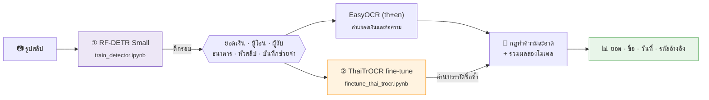

<div align="center">

# 🧾 Thai Bank Slip Reader

**อ่านสลิปโอนเงินภาษาไทยด้วยโมเดลที่เทรนเอง — ไม่ใช้ API ภายนอก**

ตีกรอบช่องบนสลิป → อ่านยอดเงิน ผู้โอน ผู้รับ → ส่งเข้าแอปบัญชีอัตโนมัติ


</div>

---

## 🔄 Pipeline



## 📁 Notebooks

| # | Notebook | หน้าที่ | ผลลัพธ์ |
|:-:|---|---|---|
| 1 | [`train_detector.ipynb`](train_detector.ipynb) | เทรนตัวตีกรอบช่องบนสลิป | `checkpoint_best_total.pth` + `id2name.json` |
| 2 | [`finetune_thai_trocr.ipynb`](finetune_thai_trocr.ipynb) | fine-tune ThaiTrOCR ให้อ่านบรรทัดชื่อแม่นขึ้น | โฟลเดอร์ `thai-trocr-slip/` |
| 3 | [`slip-ocr.ipynb`](slip-ocr.ipynb) | ใช้ทั้งสองโมเดลอ่านสลิป + วัดผลกับเฉลย | `slip_ocr_result.csv` |

---

## 1️⃣ `train_detector.ipynb` — เทรนตัวตีกรอบ

**ข้อมูล:** สลิป **260 ใบ** จาก 5 ธนาคาร พร้อม label ที่ตรวจและแก้แล้ว

| ธนาคาร | กรุงไทย | กสิกร | ออมสิน | SCB | กรุงศรี |
|---|:-:|:-:|:-:|:-:|:-:|
| จำนวนสลิป | 60 | 50 | 50 | 47 | 53 |

**Label 7 class:** `bank` · `memo` · `money` · `name` · `sent` · `silp` · `type payment`

| Split | Train | Valid | Test |
|---|:-:|:-:|:-:|
| จำนวนรูป | 181 | 52 | 27 |

**ผลเทรน** (RF-DETR Small, 50 epochs บน Kaggle T4)

| Metric | ค่า |
|---|:-:|
| mAP@50 (valid) | **0.93 – 0.94** |
| mAP@50-95 (valid) | ~0.70 |

---

## 2️⃣ `finetune_thai_trocr.ipynb` — fine-tune ThaiTrOCR อ่านบรรทัดชื่อ

> **ทำไมต้องทำ:** EasyOCR กับ ThaiTrOCR ตัวเดิมอ่านวรรณยุกต์/สระไทยในชื่อพลาด
> เช่น `ฉิมเสงี่ยม` → `ฉิมเสงียม` ซึ่งกฎทำความสะอาดแก้ไม่ได้

**ข้อมูลเทรน**
- 🧾 **บรรทัดชื่อจริง 519 บรรทัด** (ผู้โอน + ผู้รับ) ตัดจากสลิป 260 ใบ
- 🎨 **ภาพสังเคราะห์ 8,000 ภาพ** — ชื่อไทย/อังกฤษ, ชื่อร้าน/บริษัท, นามสกุลย่อ `แ.`, ชื่อที่ถูกปิด `น***`
  วาดด้วยฟอนต์ไทยฟรี 12 แบบ (Sarabun, Prompt, Kanit, IBM Plex Sans Thai, Noto Sans Thai …) + เบลอ/บีบ JPEG ให้เหมือนภาพจริง

**ผล** — วัดกับ 33 บรรทัดที่ **ชื่อไม่เคยอยู่ในชุดเทรน**

| | ตรงเป๊ะ | ผ่านเกณฑ์ | CER ↓ |
|---|:-:|:-:|:-:|
| ThaiTrOCR เดิม | 22/33 | 28/33 | 5.25% |
| **Fine-tuned** | **24/33** | **31/33** | **4.15%** |

---

## 3️⃣ `slip-ocr.ipynb` — อ่านสลิป

```
ภาพสลิป → โมเดลตีกรอบหากล่อง (money, name, sent, bank, type payment, memo, silp)
        → ตัดภาพแต่ละกล่อง → EasyOCR (th+en) + ThaiTrOCR
        → แปลงเป็นข้อมูล (ยอด ชื่อ วันที่ รหัสอ้างอิง)
```

<details>
<summary><b>เทคนิคที่ใช้เพิ่มความแม่น</b> (คลิกเพื่อดู)</summary>

| ปัญหา | วิธีแก้ |
|---|---|
| กล่องบางช่องหายเพราะความมั่นใจต่ำ (เช่นสลิป "ทรูมันนี่") | ตรวจซ้ำที่ความมั่นใจ 20% เฉพาะช่องที่หาย |
| ยอดเงินอ่านผิด เช่น `1,040` → `40` | อ่าน 2 ขนาดขอบ × 2 วิธี แล้วโหวต + ติดธงเมื่อไม่ตรงกัน |
| OCR สับสน `o`/`0`, `l`/`1` และจุดทศนิยมหาย | แก้ตัวอักษรในก้อนตัวเลข + ต่อ `3` `00` → `3.00` |
| สองโมเดลอ่านชื่อไม่ตรงกัน | ใช้ ThaiTrOCR เป็นหลัก ยกเว้นผลต่างกันมาก / มี `ฯลฯ` |
| ป้าย "จาก/ถึง", เลขบัญชี, `ํา` → `ำ` | กฎทำความสะอาดชื่อ |

</details>

**ผลกับสลิปใหม่ที่ไม่เคยเห็น**

| สลิป | ยอดเงิน | ผู้โอน | ผู้รับ |
|---|:-:|:-:|:-:|
| หน้าตาที่เทรนมา (กรุงไทย, ออมสิน) | ✅ 8/8 | ✅ 8/8 | ✅ 8/8 |
| เป๋าตัง / ttb (ยังไม่เคยเทรน) | ⚠️ | ⚠️ | ⚠️ |

---

## 🚀 วิธีรันบน Kaggle

1. **Settings** → Accelerator = `GPU T4`, Internet = `On`
2. **Add Input** → dataset รูปสลิป (แก้ `IMAGE_DIR` ในเซลล์ config ถ้าพาธต่าง)
3. **Run All** ตามลำดับ ① → ② → ③

> 💡 label และพิกัดบรรทัดชื่อฝังอยู่ใน notebook แล้ว จับคู่กับรูปด้วย **md5 ของไฟล์** จึงใช้ได้แม้ Kaggle เปลี่ยนชื่อไฟล์

<details>
<summary><b>🐛 ปัญหาที่อาจเจอ</b></summary>

| อาการ | แก้ |
|---|---|
| `RF-DETR training dependencies are missing` | `pip install "rfdetr[train,loggers]"` แล้ว Restart session |
| `unexpected keyword argument 'warmup_ratio'` | ใช้ `warmup_steps` แทน (transformers รุ่นใหม่) |
| `'list' object has no attribute 'items'` | `model.class_names` เป็น list ให้แมป id → ชื่อจาก label จริง |
| ดาวน์โหลดโฟลเดอร์จาก Output ไม่ได้ | `shutil.make_archive(...)` แล้วโหลด zip |

</details>

---

## ⚠️ ข้อควรระวัง

- รูปสลิปมี **ชื่อ เลขบัญชี และยอดเงินจริง** — เก็บ dataset และ repo เป็น **private**
- ตัวเลขบนชุด 260 ใบเดิมสูงเกินจริง (โมเดลเคยเห็นแล้ว) ตัวเลขที่ใช้อ้างอิงคือผลกับสลิปใหม่และชุดที่ไม่เคยเทรน
- รองรับเฉพาะหน้าตาสลิปของ 5 ธนาคารที่เทรนมา
